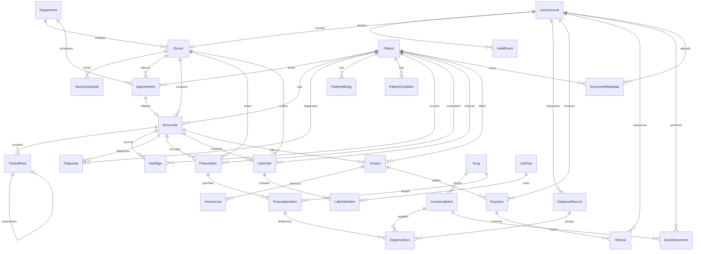

# Hospital Management System — Architecture & Database Design Specification

## 1. Executive Summary & Offline-First Principles

The Hospital Management System (HMS) is a desktop-first, fully offline, single-machine modular monolith designed for everyday clinical, administrative, and financial operations in a small hospital.

### Core Architecture Invariants
1. **Loopback Binding**: The backend binds exclusively to `127.0.0.1:5000` (loopback). Direct network exposure is restricted.
2. **Persistent Local Relational Engine**: PostgreSQL 16 operates on local storage (`%PROGRAMDATA%\HospitalApp\Data`) with strict ACID guarantees, foreign key cascades restricted on historical clinical/financial data, and versioned EF Core migrations.
3. **Local Managed File Storage**: Patient files, scanned identity docs, and lab attachments are held in `%PROGRAMDATA%\HospitalApp\Documents` indexed by immutable internal UUIDs and cryptographically verified by SHA-256 hashes.
4. **No Cloud Dependency**: Zero reliance on cloud identity (Firebase/Supabase), CDNs, remote analytics, or external time/telemetry services.

---

## 2. Role-Based Access Control (RBAC) Matrix

Permissions are strictly enforced on backend endpoints and query filters. UI button visibility is purely an ergonomic aid.

| Capability / Resource | Super Admin | Hospital Admin | Receptionist | Doctor | Nurse | Lab Tech | Pharmacist | Cashier | Auditor |
|---|:---:|:---:|:---:|:---:|:---:|:---:|:---:|:---:|:---:|
| **User & Role Administration** | Full | Scoped | None | None | None | None | None | None | Read |
| **Patient Demographics (Create/Edit)** | Yes | Yes | Yes | Limited | Limited | None | None | Limited | Read |
| **View Clinical History / Notes** | Break-Glass | Limited | None | Assigned | Assigned | Order-only | Rx-only | None | Audited |
| **Create / Sign Encounter & Notes** | None | None | None | Yes | Nursing | None | None | None | None |
| **Appointment Scheduling & Queue** | Full | Full | Full | Own | Assigned | None | None | None | Read |
| **Lab Orders & Specimen Barcoding** | None | None | None | Order | Collect | Order/Work | None | None | Read |
| **Lab Result Entry & Verification** | None | None | None | Review | None | Enter/Verify | None | None | Read |
| **Pharmacy Dispensing & Inventory** | None | None | None | Prescribe | None | None | Full | None | Read |
| **Invoice Generation & Billing** | None | Setup | View | Order-link | None | None | Rx-link | Full | Read |
| **Payment Capture & Refunds** | None | Approve | None | None | None | None | None | Pay/Refund* | Read |
| **Audit Log Inspection** | Full | Scoped | None | None | None | None | None | Financial | Full |

*Refunds above policy threshold require supervisor approval.

---

## 3. Entity-Relationship Diagram (ERD)

---

## 4. Detailed Database Schema Specifications

The database consists of 30 normalized tables mapped via EF Core to PostgreSQL.

### 4.1 Identity & Administration
1. **UserAccounts**
   - `Id` (UUID, PK)
   - `Username` (text, UNIQUE)
   - `Email` (text, NOT NULL)
   - `PasswordHash` (text, NOT NULL — BCrypt with work factor 12)
   - `FullName` (text, NOT NULL)
   - `Role` (integer, NOT NULL: 0=Admin, 1=HospitalAdmin, 2=Reception, 3=Doctor, 4=Nurse, 5=Lab, 6=Pharmacist, 7=Cashier, 8=Auditor)
   - `IsActive` (boolean, default true)
   - `FailedLoginAttempts` (integer, default 0)
   - `LockoutUntil` (timestamp with time zone, nullable)
   - `LastLoginAt` (timestamp with time zone, nullable)
   - `CreatedAt`, `UpdatedAt` (timestamp with time zone)

2. **AuditEvents**
   - `Id` (UUID, PK)
   - `ActorUserId` (UUID, FK -> UserAccounts.Id, nullable)
   - `ActorUsername` (text, NOT NULL)
   - `Action` (text, NOT NULL) — e.g., "Patient.Created", "Prescription.Dispensed", "Payment.Captured"
   - `EntityName` (text, NOT NULL)
   - `EntityId` (text, NOT NULL)
   - `Details` (text, nullable — JSON payload with sensitive data minimized)
   - `IpAddress` (text, NOT NULL)
   - `Timestamp` (timestamp with time zone, NOT NULL)

3. **Departments**
   - `Id` (UUID, PK)
   - `Code` (text, UNIQUE, NOT NULL) — e.g. "CARD", "OPD", "PEDS"
   - `Name` (text, NOT NULL)
   - `IsActive` (boolean, default true)
   - `CreatedAt`, `UpdatedAt` (timestamp with time zone)

4. **Doctors**
   - `Id` (UUID, PK)
   - `UserId` (UUID, UNIQUE, FK -> UserAccounts.Id)
   - `DepartmentId` (UUID, FK -> Departments.Id)
   - `LicenseNumber` (text, NOT NULL)
   - `Specialization` (text, NOT NULL)
   - `ConsultationFee` (decimal(18,2), default 0)
   - `IsActive` (boolean, default true)
   - `CreatedAt`, `UpdatedAt` (timestamp with time zone)

5. **DoctorSchedules**
   - `Id` (UUID, PK)
   - `DoctorId` (UUID, FK -> Doctors.Id)
   - `DayOfWeek` (integer, NOT NULL: 0=Sunday..6=Saturday)
   - `StartTime` (time without time zone, NOT NULL)
   - `EndTime` (time without time zone, NOT NULL)
   - `SlotDurationMinutes` (integer, default 15)
   - `IsActive` (boolean, default true)
   - `CreatedAt`, `UpdatedAt` (timestamp with time zone)

### 4.2 Patient Domain
6. **Patients**
   - `Id` (UUID, PK)
   - `PatientNumber` (text, UNIQUE, NOT NULL) — format: `HSP-YYYY-XXXXX`
   - `FirstName` (text, NOT NULL)
   - `LastName` (text, NOT NULL)
   - `DateOfBirth` (timestamp with time zone, NOT NULL)
   - `Gender` (text, NOT NULL) — "Male", "Female", "Other"
   - `BloodGroup` (text, nullable)
   - `Phone` (text, NOT NULL, Indexed)
   - `Email` (text, nullable)
   - `Address` (text, nullable)
   - `EmergencyContactName` (text, nullable)
   - `EmergencyContactPhone` (text, nullable)
   - `IsActive` (boolean, default true)
   - `CreatedAt`, `UpdatedAt` (timestamp with time zone)

7. **PatientAllergies**
   - `Id` (UUID, PK)
   - `PatientId` (UUID, FK -> Patients.Id)
   - `Allergen` (text, NOT NULL)
   - `Reaction` (text, NOT NULL)
   - `Severity` (integer, NOT NULL: 0=Mild, 1=Moderate, 2=Severe, 3=LifeThreatening)
   - `RecordedAt`, `CreatedAt`, `UpdatedAt` (timestamp with time zone)

8. **PatientConditions**
   - `Id` (UUID, PK)
   - `PatientId` (UUID, FK -> Patients.Id)
   - `ConditionName` (text, NOT NULL)
   - `Status` (text, NOT NULL) — "Active", "Resolved", "Chronic"
   - `DiagnosedDate` (timestamp with time zone, nullable)
   - `CreatedAt`, `UpdatedAt` (timestamp with time zone)

### 4.3 Appointments & Clinical Workflows
9. **Appointments**
   - `Id` (UUID, PK)
   - `AppointmentNumber` (text, UNIQUE, NOT NULL)
   - `PatientId` (UUID, FK -> Patients.Id)
   - `DoctorId` (UUID, FK -> Doctors.Id)
   - `DepartmentId` (UUID, FK -> Departments.Id)
   - `StartsAt` (timestamp with time zone, NOT NULL)
   - `EndsAt` (timestamp with time zone, NOT NULL)
   - `Status` (integer, NOT NULL: 0=Booked, 1=Confirmed, 2=Arrived, 3=Waiting, 4=InConsultation, 5=Completed, 6=Cancelled, 7=NoShow, 8=ReschedulePending)
   - `Reason` (text, nullable)
   - `CancellationReason` (text, nullable)
   - `IdempotencyKey` (text, nullable, Indexed)
   - `CreatedAt`, `UpdatedAt` (timestamp with time zone)

10. **Encounters**
    - `Id` (UUID, PK)
    - `PatientId` (UUID, FK -> Patients.Id)
    - `AppointmentId` (UUID, FK -> Appointments.Id, nullable)
    - `DoctorId` (UUID, FK -> Doctors.Id)
    - `StartedAt` (timestamp with time zone, NOT NULL)
    - `EndedAt` (timestamp with time zone, nullable)
    - `Status` (integer, NOT NULL: 0=Open, 1=InProgress, 2=Draft, 3=Signed, 4=Closed, 5=AmendedByAddendum)
    - `SignedAt` (timestamp with time zone, nullable)
    - `SignedByDoctorId` (UUID, FK -> Doctors.Id, nullable)
    - `CreatedAt`, `UpdatedAt` (timestamp with time zone)

11. **ClinicalNotes**
    - `Id` (UUID, PK)
    - `EncounterId` (UUID, FK -> Encounters.Id)
    - `ChiefComplaint` (text, NOT NULL)
    - `HistoryOfPresentIllness` (text, nullable)
    - `ExaminationFindings` (text, nullable)
    - `Assessment` (text, nullable)
    - `TreatmentPlan` (text, nullable)
    - `Version` (integer, default 1)
    - `IsFinalized` (boolean, default false)
    - `SupersedesNoteId` (UUID, FK -> ClinicalNotes.Id, nullable)
    - `AmendmentReason` (text, nullable)
    - `CreatedAt`, `UpdatedAt` (timestamp with time zone)

12. **VitalSigns**
    - `Id` (UUID, PK)
    - `EncounterId` (UUID, FK -> Encounters.Id)
    - `PatientId` (UUID, FK -> Patients.Id)
    - `RecordedByUserId` (UUID, FK -> UserAccounts.Id)
    - `SystolicBp` (integer, nullable)
    - `DiastolicBp` (integer, nullable)
    - `HeartRateBpm` (integer, nullable)
    - `RespiratoryRateBpm` (integer, nullable)
    - `TemperatureCelsius` (decimal(4,1), nullable)
    - `OxygenSaturationPct` (decimal(4,1), nullable)
    - `WeightKg` (decimal(5,2), nullable)
    - `HeightCm` (decimal(5,1), nullable)
    - `RecordedAt`, `CreatedAt`, `UpdatedAt` (timestamp with time zone)

13. **Diagnoses**
    - `Id` (UUID, PK)
    - `EncounterId` (UUID, FK -> Encounters.Id)
    - `PatientId` (UUID, FK -> Patients.Id)
    - `Icd10Code` (text, nullable)
    - `Description` (text, NOT NULL)
    - `IsPrimary` (boolean, default false)
    - `RecordedAt`, `CreatedAt`, `UpdatedAt` (timestamp with time zone)

### 4.4 Laboratory Management
14. **LabTests**
    - `Id` (UUID, PK)
    - `Code` (text, UNIQUE, NOT NULL)
    - `Name` (text, NOT NULL)
    - `Category` (text, NOT NULL) — e.g. "Hematology", "Biochemistry", "Microbiology"
    - `SpecimenType` (text, NOT NULL) — "Serum", "Whole Blood", "Urine", "Swab"
    - `UnitOfMeasure` (text, nullable)
    - `ReferenceRange` (text, nullable)
    - `Price` (decimal(18,2), NOT NULL)
    - `IsActive` (boolean, default true)
    - `CreatedAt`, `UpdatedAt` (timestamp with time zone)

15. **LabOrders**
    - `Id` (UUID, PK)
    - `OrderNumber` (text, UNIQUE, NOT NULL)
    - `EncounterId` (UUID, FK -> Encounters.Id)
    - `PatientId` (UUID, FK -> Patients.Id)
    - `OrderedByDoctorId` (UUID, FK -> Doctors.Id)
    - `Priority` (integer, NOT NULL: 0=Routine, 1=Urgent, 2=Stat)
    - `Status` (integer, NOT NULL: 0=Ordered, 1=Collected, 2=Received, 3=Processing, 4=DraftResult, 5=Verified, 6=Released, 7=Corrected, 8=Cancelled, 9=Rejected)
    - `CreatedAt`, `UpdatedAt` (timestamp with time zone)

16. **LabOrderItems**
    - `Id` (UUID, PK)
    - `LabOrderId` (UUID, FK -> LabOrders.Id)
    - `LabTestId` (UUID, FK -> LabTests.Id)
    - `SpecimenBarcode` (text, nullable, Indexed)
    - `SpecimenCollectedAt` (timestamp with time zone, nullable)
    - `ResultValue` (text, nullable)
    - `ResultUnit` (text, nullable)
    - `ReferenceRangeSnapshot` (text, nullable)
    - `IsAbnormal` (boolean, default false)
    - `Comments` (text, nullable)
    - `EnteredByUserId` (UUID, FK -> UserAccounts.Id, nullable)
    - `VerifiedByUserId` (UUID, FK -> UserAccounts.Id, nullable)
    - `VerifiedAt` (timestamp with time zone, nullable)
    - `CreatedAt`, `UpdatedAt` (timestamp with time zone)

### 4.5 Pharmacy & Inventory
17. **Drugs**
    - `Id` (UUID, PK)
    - `Code` (text, UNIQUE, NOT NULL)
    - `BrandName` (text, NOT NULL)
    - `GenericName` (text, NOT NULL)
    - `DosageForm` (text, NOT NULL) — "Tablet", "Capsule", "Injection", "Syrup"
    - `Strength` (text, NOT NULL) — "500mg", "10mg/ml"
    - `ReorderLevel` (integer, default 10)
    - `IsActive` (boolean, default true)
    - `CreatedAt`, `UpdatedAt` (timestamp with time zone)

18. **InventoryBatches**
    - `Id` (UUID, PK)
    - `DrugId` (UUID, FK -> Drugs.Id)
    - `BatchNumber` (text, NOT NULL)
    - `ExpiryDate` (timestamp with time zone, NOT NULL, Indexed)
    - `QuantityReceived` (integer, NOT NULL)
    - `QuantityOnHand` (integer, NOT NULL)
    - `UnitCost` (decimal(18,2), NOT NULL)
    - `SellingPrice` (decimal(18,2), NOT NULL)
    - `Status` (integer, NOT NULL: 0=Available, 1=Quarantined, 2=Expired, 3=Recalled, 4=Depleted)
    - `CreatedAt`, `UpdatedAt` (timestamp with time zone)

19. **Prescriptions**
    - `Id` (UUID, PK)
    - `PrescriptionNumber` (text, UNIQUE, NOT NULL)
    - `EncounterId` (UUID, FK -> Encounters.Id)
    - `PatientId` (UUID, FK -> Patients.Id)
    - `DoctorId` (UUID, FK -> Doctors.Id)
    - `SignedAt` (timestamp with time zone, NOT NULL)
    - `Status` (integer, NOT NULL: 0=Draft, 1=Signed, 2=PartiallyDispensed, 3=Dispensed, 4=Cancelled, 5=Expired)
    - `CreatedAt`, `UpdatedAt` (timestamp with time zone)

20. **PrescriptionItems**
    - `Id` (UUID, PK)
    - `PrescriptionId` (UUID, FK -> Prescriptions.Id)
    - `DrugId` (UUID, FK -> Drugs.Id)
    - `Dosage` (text, NOT NULL)
    - `Frequency` (text, NOT NULL) — "TDS", "BD", "OD", "PRN"
    - `Route` (text, NOT NULL) — "Oral", "IV", "IM", "Topical"
    - `DurationDays` (integer, NOT NULL)
    - `QuantityPrescribed` (integer, NOT NULL)
    - `QuantityDispensed` (integer, default 0)
    - `Instructions` (text, nullable)
    - `CreatedAt`, `UpdatedAt` (timestamp with time zone)

21. **DispenseRecords**
    - `Id` (UUID, PK)
    - `PrescriptionId` (UUID, FK -> Prescriptions.Id)
    - `PharmacistUserId` (UUID, FK -> UserAccounts.Id)
    - `DispensedAt` (timestamp with time zone, NOT NULL)
    - `IdempotencyKey` (text, UNIQUE, NOT NULL)
    - `CreatedAt`, `UpdatedAt` (timestamp with time zone)

22. **DispenseItems**
    - `Id` (UUID, PK)
    - `DispenseRecordId` (UUID, FK -> DispenseRecords.Id)
    - `PrescriptionItemId` (UUID, FK -> PrescriptionItems.Id)
    - `InventoryBatchId` (UUID, FK -> InventoryBatches.Id)
    - `Quantity` (integer, NOT NULL)
    - `UnitPriceSnapshot` (decimal(18,2), NOT NULL)
    - `CreatedAt`, `UpdatedAt` (timestamp with time zone)

23. **StockMovements**
    - `Id` (UUID, PK)
    - `InventoryBatchId` (UUID, FK -> InventoryBatches.Id)
    - `MovementType` (integer, NOT NULL: 0=Initial, 1=PurchaseReceived, 2=Dispensed, 3=ReturnToStock, 4=AdjustmentIncrease, 5=AdjustmentDecrease, 6=ExpiredWastage, 7=Damaged)
    - `QuantityDelta` (integer, NOT NULL)
    - `BalanceAfter` (integer, NOT NULL)
    - `ReferenceId` (text, NOT NULL) — e.g. DispenseRecordId or StocktakeId
    - `Reason` (text, NOT NULL)
    - `PerformedByUserId` (UUID, FK -> UserAccounts.Id)
    - `CreatedAt`, `UpdatedAt` (timestamp with time zone)

### 4.6 Billing & Payments
24. **ServiceItems**
    - `Id` (UUID, PK)
    - `Code` (text, UNIQUE, NOT NULL)
    - `Name` (text, NOT NULL)
    - `Category` (text, NOT NULL) — "Consultation", "Procedure", "Nursing", "Room"
    - `DefaultPrice` (decimal(18,2), NOT NULL)
    - `IsActive` (boolean, default true)
    - `CreatedAt`, `UpdatedAt` (timestamp with time zone)

25. **Invoices**
    - `Id` (UUID, PK)
    - `InvoiceNumber` (text, UNIQUE, NOT NULL) — format: `INV-YYYY-XXXXX`
    - `PatientId` (UUID, FK -> Patients.Id)
    - `EncounterId` (UUID, FK -> Encounters.Id, nullable)
    - `CreatedByUserId` (UUID, FK -> UserAccounts.Id)
    - `IssuedAt` (timestamp with time zone, NOT NULL)
    - `Subtotal` (decimal(18,2), NOT NULL)
    - `Discount` (decimal(18,2), default 0)
    - `Tax` (decimal(18,2), default 0)
    - `Total` (decimal(18,2), NOT NULL)
    - `PaidAmount` (decimal(18,2), default 0)
    - `Balance` (decimal(18,2), NOT NULL)
    - `Status` (integer, NOT NULL: 0=Draft, 1=Issued, 2=PartiallyPaid, 3=Paid, 4=Voided, 5=RefundedPartially, 6=RefundedFully)
    - `CreatedAt`, `UpdatedAt` (timestamp with time zone)

26. **InvoiceLines**
    - `Id` (UUID, PK)
    - `InvoiceId` (UUID, FK -> Invoices.Id)
    - `SourceType` (text, NOT NULL) — "Consultation", "LabTest", "Drug", "Service"
    - `SourceId` (text, NOT NULL) — FK reference as text
    - `ItemDescription` (text, NOT NULL)
    - `Quantity` (integer, NOT NULL)
    - `UnitPriceSnapshot` (decimal(18,2), NOT NULL)
    - `TotalPrice` (decimal(18,2), NOT NULL)
    - `CreatedAt`, `UpdatedAt` (timestamp with time zone)

27. **Payments**
    - `Id` (UUID, PK)
    - `ReceiptNumber` (text, UNIQUE, NOT NULL) — format: `REC-YYYY-XXXXX`
    - `InvoiceId` (UUID, FK -> Invoices.Id)
    - `CashierUserId` (UUID, FK -> UserAccounts.Id)
    - `Amount` (decimal(18,2), NOT NULL)
    - `Method` (integer, NOT NULL: 0=Cash, 1=CreditCard, 2=DebitCard, 3=BankTransfer, 4=MobilePayment, 5=InsuranceCoPay)
    - `ProviderReference` (text, nullable)
    - `IdempotencyKey` (text, UNIQUE, NOT NULL)
    - `ReceivedAt` (timestamp with time zone, NOT NULL)
    - `CreatedAt`, `UpdatedAt` (timestamp with time zone)

28. **Refunds**
    - `Id` (UUID, PK)
    - `PaymentId` (UUID, FK -> Payments.Id)
    - `AuthorizedByUserId` (UUID, FK -> UserAccounts.Id)
    - `Amount` (decimal(18,2), NOT NULL)
    - `Reason` (text, NOT NULL)
    - `RefundedAt` (timestamp with time zone, NOT NULL)
    - `CreatedAt`, `UpdatedAt` (timestamp with time zone)

### 4.7 Documents & System Settings
29. **DocumentMetadata**
    - `Id` (UUID, PK)
    - `PatientId` (UUID, FK -> Patients.Id)
    - `EncounterId` (UUID, FK -> Encounters.Id, nullable)
    - `UploadedByUserId` (UUID, FK -> UserAccounts.Id)
    - `FileName` (text, NOT NULL — sanitized filename)
    - `StoragePath` (text, NOT NULL — relative storage path)
    - `MimeType` (text, NOT NULL)
    - `SizeBytes` (bigint, NOT NULL)
    - `Sha256Hash` (text, NOT NULL)
    - `Category` (integer, NOT NULL: 0=General, 1=LabReport, 2=Prescription, 3=Scan, 4=Referral, 5=Identity)
    - `CreatedAt`, `UpdatedAt` (timestamp with time zone)

30. **SystemSettings**
    - `Key` (text, PK)
    - `Value` (text, NOT NULL)
    - `Description` (text, NOT NULL)
    - `UpdatedAt` (timestamp with time zone, NOT NULL)

---

## 5. Core Business Rules & Transaction Integrity

### 5.1 Concurrency & Idempotency Rules
1. **Appointment Double-Booking Prevention**:
   - Every booking execution checks clinician schedule interval overlaps inside an explicit serializable/repeatable-read transaction.
   - Any conflicting slot request aborts with `409 Conflict`.
2. **Pharmacy FEFO Dispensing**:
   - Stock is automatically allocated from active batches sorted by `ExpiryDate ASC`.
   - Expired batches (`ExpiryDate < Now`) or depleted batches cannot be dispensed.
   - An explicit database transaction locks the batch row, validates `QuantityOnHand >= QuantityToDispense`, decrements `QuantityOnHand`, inserts `DispenseItem`, inserts `StockMovement`, and increments `QuantityDispensed` on the prescription item.
   - Negative inventory is strictly prohibited.
3. **Financial Invariance & Decimal Calculation**:
   - Invoices, invoice lines, payments, and refunds exclusively use PostgreSQL `numeric` (`decimal(18,2)` in C#).
   - Invariant: `Invoice.Balance = Invoice.Total - Invoice.PaidAmount`.
   - An invoice cannot be marked `Paid` unless `Balance == 0`.
   - Duplicate submissions with the same `IdempotencyKey` return the existing committed transaction result without creating duplicate records.

---

## 6. Audit & Recovery Strategy

### 6.1 Audit Invariants
- All sensitive operations (authentication events, clinical sign/amend, prescription dispensing, lab result verification, invoice void/refund, and user role modifications) insert immutable records into `AuditEvents`.
- Direct `DELETE` or `UPDATE` statements on `AuditEvents` are forbidden.

### 6.2 Backup & Disaster Recovery
- **Hot Backup Strategy**: Automated daily invocation of `pg_dump` targeting `%PROGRAMDATA%\HospitalApp\Backups\db_YYYYMMDD_HHMMSS.dump` (custom compressed format).
- **Document Backup**: File attachments in `%PROGRAMDATA%\HospitalApp\Documents` are mirrored or packaged alongside the database dump.
- **External Destination Support**: Administrators can configure a secondary external USB drive destination path.
- **Restoration Drill**: Verified using `pg_restore --clean --if-exists` followed by database health check and record count reconciliation.
